# M80 Mainframe

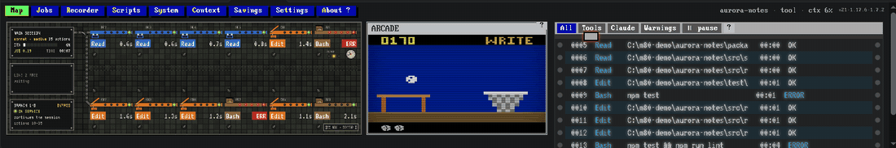

Retro 1980s and clean modern themes for VS Code, a live console for [Claude Code](https://claude.com/claude-code), and a one-click installer for the M80 Claude Code components. Windows 10/11, VS Code 1.85 or newer.

M80 Mainframe has three parts. You can use the first two without Claude Code.

1. **34 color themes** (17 looks, each in an original and a soft version) and a menu to switch between them.
2. **The M80 Console**: a panel next to your terminal that shows what Claude Code is doing, what it costs and how full its context is, with a map, an arcade and several tools.
3. **The M80 components for Claude Code** (optional, installed only if you say yes): hooks, the `m80-motor` plugin, Claude themes, a project template and IBM fonts.

## Themes

Seven retro looks and ten modern ones. Every look has an **original** and a **soft** version (same colors, lower contrast for long sessions).

| Retro | Modern |
|---|---|
| Clipper Summer 87, Turbo Pascal 7, Norton Commander 5, Green Phosphor 5151, dBase III Amber, LapLink White Paper, Quarterdeck Manifest | Graphite, Midnight, Daylight, Porcelain, Forest, Dusk, Ember, Ocean, Contrast, Mist |

The switch changes the whole editor, the terminal colors and the M80 Console together.

| | | |
|---|---|---|
| 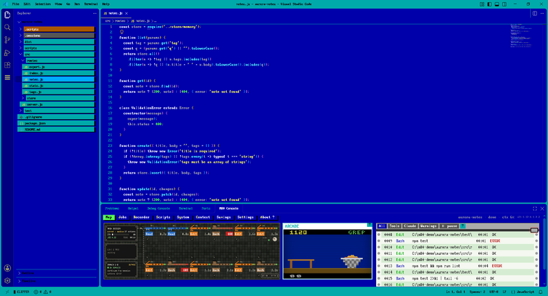 Clipper Summer 87 | 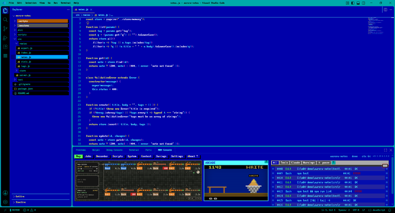 Norton Commander 5 | 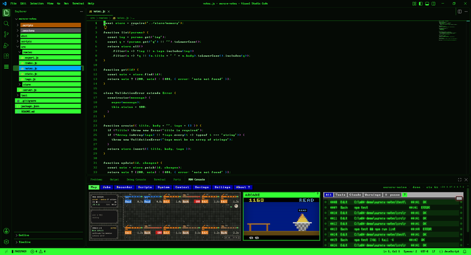 Green Phosphor 5151 |
| 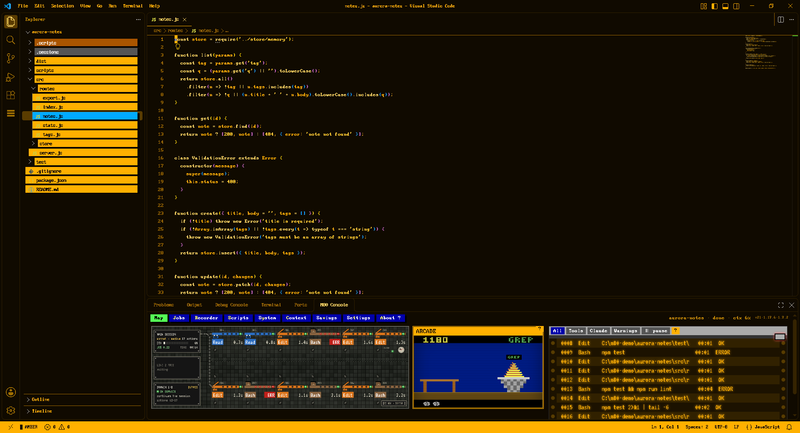 dBase III Amber | 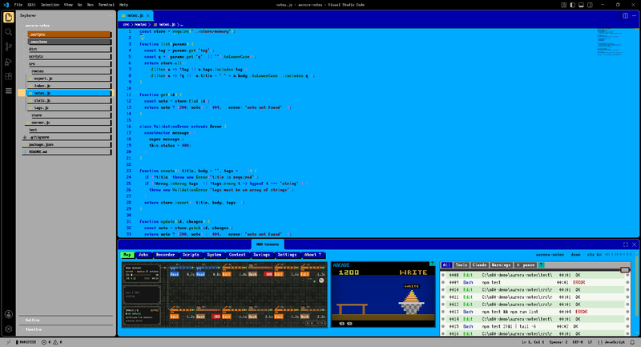 Quarterdeck Manifest | 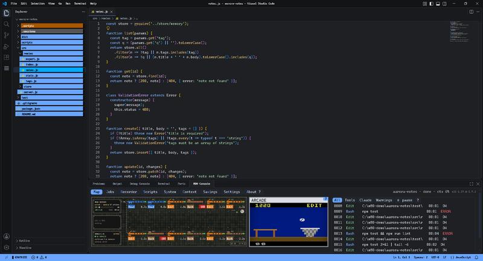 Graphite |
| 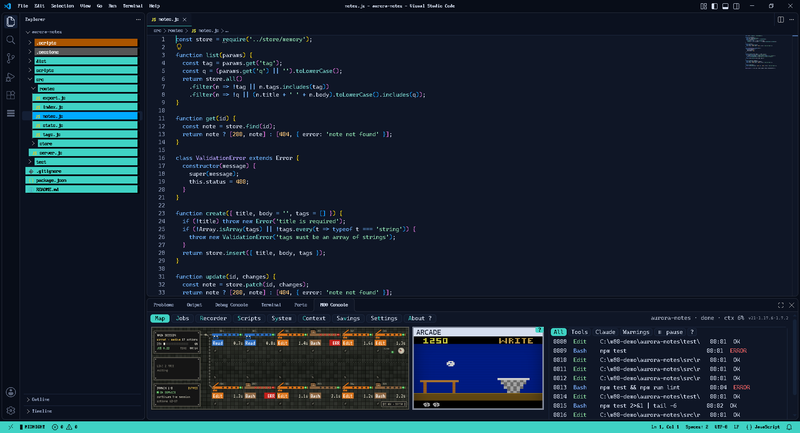 Midnight | 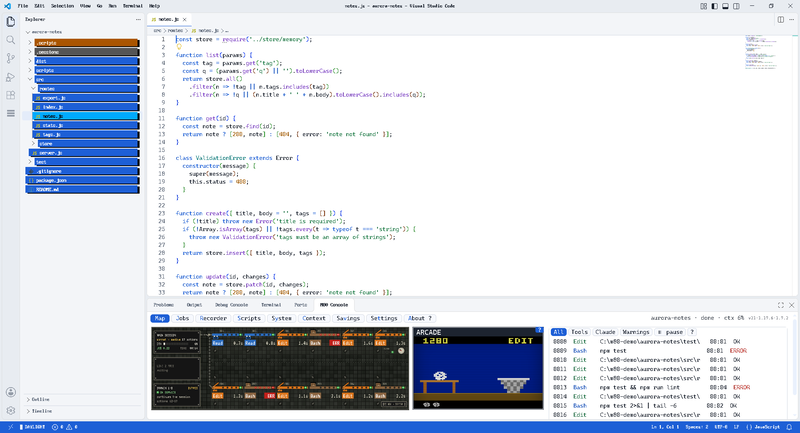 Daylight | 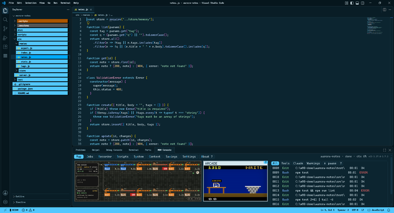 Ocean |

| Keys | Action |
|---|---|
| `Ctrl+Alt+F9` | Open the list of looks |
| `Ctrl+Alt+F1` … `F7` | Go straight to one retro look |
| `Ctrl+Alt+F10` | Toggle original / soft |
| `Ctrl+Alt+O` | Open the M80 Console |
| `Ctrl+Alt+M` | Open the M80 Manifest menu in the side bar |

Everything is also in the Command Palette under **M80:**.

## The M80 Console

A panel tab (next to Ports) with one screen per tab. It reads what the M80 plugin for Claude Code writes locally on your computer, so the data is live and nothing leaves your machine.

| Tab | What it shows |
|---|---|
| **Map** | Claude's tools, agents and files drawn as a live map. Four views: Synoptic, Teletext, Circuit and Radar. An effect plays when a tool finishes. |
| **Jobs** | Running jobs and subagents. |
| **Recorder** | A log of what happened in the session. |
| **Scripts** | Run your project scripts in a tab with live output, answer prompts and stop them. |
| **System** | CPU cores and memory use on your machine. |
| **Context** | How full each Claude conversation is, cache use, memory budget and open tabs. |
| **Savings** | Token and cost savings, per model, with the estimated US$ cost. |
| **Settings** | Look, map view, interface shape, effects and Arcade. |
| **About ?** | Versions of the extension, the plugin, the hooks and the project template, with a health check. |

**Context**: how full the conversation is, cache, what fills the context and the memory budget.

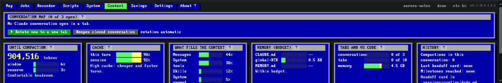

**Savings**: money saved by the prompt cache and the model router in this session.

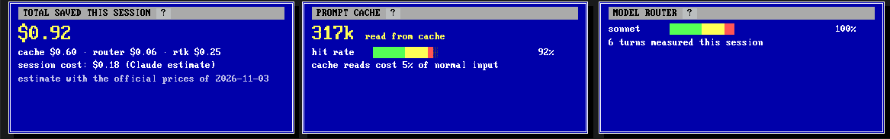

**Scripts**: run your project scripts with live output, without opening a window.

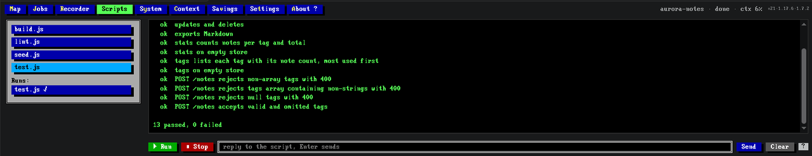

### Arcade

A window in the Map plays one of **15 classic arcade games, redrawn in our own style** (River Raid, Megamania, Keystone Kapers, Kaboom!, Missile Command, Pitfall!, Space Invaders, Frogger, Asteroids, Pong, Enduro, Pac-Man and more) when a tool finishes. You can hide the window in **Settings → Arcade window in the Map**, and set when effects animate (follow the system, always, never).

### Continuity

Claude Code conversations lose quality as the context fills. The console helps:

- A summary of the work is saved automatically at **60%, 75% and 85%** of context.
- **M80: Rotate to a new conversation** opens a fresh conversation that starts from that summary. Rotation can be automatic or by button, and the number of Claude tabs kept open is configurable.

## M80 components for Claude Code (optional)

On the first run the extension **asks** whether to install these. Nothing is written without your confirmation, and you can see the exact list first (**What changes**).

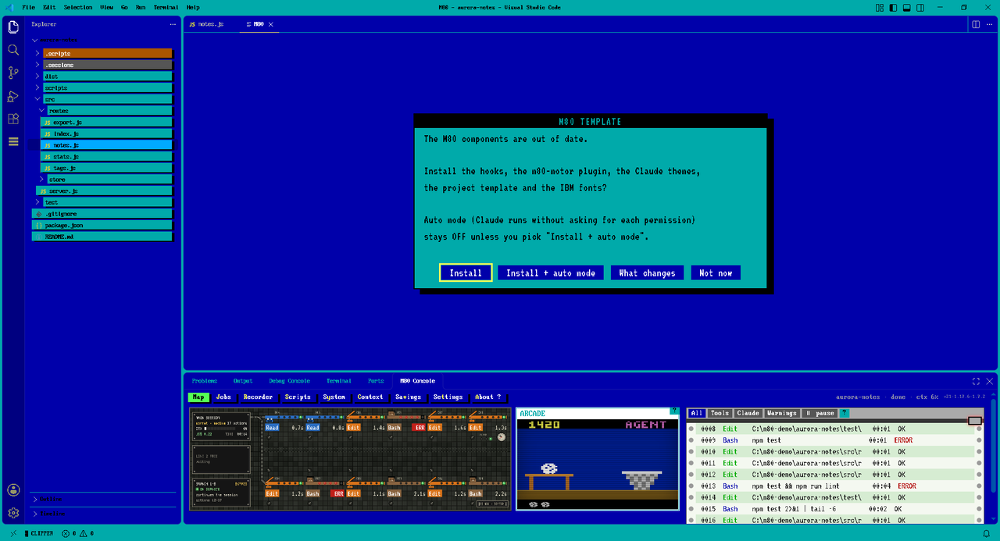

| Component | What it does |
|---|---|
| **`m80-motor` plugin** | Picks the model and effort per request (simple work on a smaller model, hard work on a larger one), blocks destructive commands (recursive delete at the drive root, `git push --force`, `git reset --hard`, cloud write commands), shows a status bar (state, model, effort, context, cost, time) and guides the compaction summary. Commands: `/m80-modo`, `/m80-status`. |
| **6 hooks** | Rules enforcement (blocks answers that claim a result without having run anything, blocks commits and deletions you did not ask for), task-completion gate, continuity summary on session start, project setup. |
| **Project template** | New projects get a folder layout, a `CLAUDE.md` with working rules, three agents (`Explore`, `validador-visual`, `verificador`), the `/m80-faxina` memory cleanup skill and a Windows pitfalls guide. |
| **17 Claude themes** | The same looks, for Claude Code's own interface. |
| **8 IBM VGA fonts** | Px437 and PxPlus IBM VGA/EGA/MDA, for the retro looks. |

Where it writes (all under your user profile): `~/.claude/hooks/m80/`, `~/.claude/themes/`, `~/.claude/m80/` and your user fonts. It **merges** hooks, the plugin and a local marketplace into `~/.claude/settings.json`, keeps everything that was already there and saves a backup next to it. It runs `claude plugin install m80-motor@m80` through the Claude CLI.

**Auto mode is off by default.** The pop-up has two install buttons: **Install** (no change to your permission mode) and **Install + auto mode**, which also sets Claude Code's `defaultMode` to `auto` and turns on its task-list variables (`CLAUDE_CODE_ENABLE_TODO_TOOLS`, `CLAUDE_CODE_ENABLE_TASKS`). Auto mode lets Claude run without asking for each permission, so choose it only if you want that. Uninstalling leaves these two settings as they are, so remove them yourself if you turned them on.

To remove everything: **M80: Uninstall components**. Your own settings stay. Projects already created keep their files.

The installer works on **Windows only** for now. Themes and the console do not need it.

## Settings

| Setting | Values |
|---|---|
| `m80.monitor.layout` | `sinotico`, `teletexto`, `circuito`, `radar` |
| `m80.monitor.forma` | `auto`, `manifest`, `fosforo`, `lotus`, `norton`, `moderna` |
| `m80.efeitos.mapa` | none, or one of the arcade games and effects (desk trash, River Raid, Megamania, Keystone Kapers, Kaboom!, Missile Command, Pitfall!, Space Invaders, Frogger, Asteroids, Pong, Enduro, Pac-Man, Block Well, Blast, Fireworks Sky) |
| `m80.efeitos.animar` | `sistema` (follow system), `sempre`, `nunca` |
| `m80.monitor.arcade` | `shown`, `hidden` |
| `m80.rotacao` | `automatica`, `botao` |
| `m80.maxConversas` | number of Claude tabs kept open |

## Privacy and safety

- The extension and the M80 hooks and plugin contain **no network calls** (checked by searching the code for URLs, fetch and HTTP clients). The console reads files that the plugin writes on your own machine. The model router may ask a small Claude model to classify a request, and that goes through Claude Code itself.
- The package contains **no keys, tokens or passwords**. Before every release it is scanned for secrets, private paths and forbidden files, and the build stops if anything is found.
- The installer asks first, backs up `settings.json`, and can undo what it did.
- Source and issues: https://github.com/m4r6i0/m80-mainframe

## Requirements

- Windows 10 or 11, VS Code 1.85 or newer.
- For the Claude components: [Claude Code](https://claude.com/claude-code) installed (the `claude` command). Third-party Claude plugins (superpowers, context7 and others) are **not** included and not required.

## Credits and licenses

M80 Mainframe is MIT licensed. The IBM VGA fonts are by VileR ([Ultimate Oldschool PC Font Pack](https://int10h.org/oldschool-pc-fonts/), CC BY-SA 4.0). VT323 is under the SIL Open Font License 1.1. Details in `THIRD-PARTY-NOTICES.md`. Game names are used only to describe the style of each effect; this project is not affiliated with their owners.
